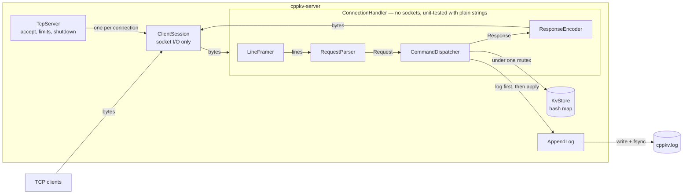

# CppKV

[](https://github.com/udayshinde75/CppKV/actions/workflows/ci.yml)

A key-value database server in modern C++20, built to be **correct under concurrency, crashes and bad input, and
honestly measured**. Clients connect over TCP and use a small, documented text protocol; every write goes to a
checksummed append-only log before it is acknowledged, so data survives `kill -9`.

CppKV is an independent learning project inspired by Redis. It reuses no Redis code and does not aim for Redis
protocol or feature compatibility.

```console
$ nc 127.0.0.1 7379
SET city Frankfurt am Main
OK
GET city
VALUE 17 Frankfurt am Main
DEL city
INT 1
QUIT
BYE
```

## What it does

- **Seven commands** — `PING`, `SET`, `GET`, `DEL`, `EXISTS`, `DBSIZE`, `QUIT` — over a line protocol that handles
  requests split across TCP reads and many requests in one read ([protocol spec](docs/protocol.md)).
- **Many clients at once** on a fixed pool of I/O threads (Boost.Asio), with a connection limit
  ([ADR 0002](docs/adr/0002-concurrency-model.md)).
- **Durable writes:** an append-only log with a CRC per record, written *before* the change is applied, with a
  choice between syncing every write, every second, or never. After a crash it replays the log; a half-written
  last record is cut off, real corruption stops the server instead of silently losing data
  ([ADR 0003](docs/adr/0003-persistence.md)).
- **Operable:** graceful shutdown on Ctrl-C/SIGTERM that answers what was already sent, timeouts for idle and
  stalled clients, bounded memory per client, recovery from running out of file descriptors, clear log lines and
  exit codes ([ADR 0004](docs/adr/0004-operations.md)).
- **Measured:** micro-benchmarks and a load generator with correct latency percentiles; two real problems were
  found by measuring that no test could see ([benchmarks](docs/benchmarks.md)).
- **Checked:** 234 tests, sanitizer-clean (AddressSanitizer, UndefinedBehaviorSanitizer, LeakSanitizer,
  ThreadSanitizer), 94 % line coverage, deliberate-bug ("mutation") checks, CI on Linux and macOS
  ([quality](docs/quality.md)).

## Try it

```bash
# macOS:           brew install cmake ninja boost
# Ubuntu 24.04:    sudo apt install build-essential cmake ninja-build libboost-dev git
cmake --preset debug && cmake --build --preset debug && ctest --preset debug

scripts/demo.sh                          # 2-minute tour: commands, pipelining, kill -9 and recovery, load test
./build/debug/src/cppkv-server           # or run it yourself: 127.0.0.1:7379, data in ./data
```

## How it works



- **Sans-I/O core.** Everything from bytes-in to bytes-out lives in `ConnectionHandler`, which has no sockets, so
  every protocol rule, including every way TCP can split a request, is tested with plain strings. Only
  `ClientSession` and `TcpServer` touch the network.
- **Threads.** One `io_context` runs on `--threads` threads; each connection has a *strand*, so its handlers never
  run concurrently; the store is shared under one `std::mutex`. A slow client costs memory, never a thread.
- **Write path.** `SET` → encode a record (length + CRC-32) → `write` → `fsync` (per `--sync`) → update memory →
  `OK`. The log and memory change under the same lock, so the log order is the order clients observed.
- **Back-pressure.** A connection produces at most ~64 KiB of replies before they are written, and stops reading
  while a write is blocked, so a client that never reads cannot make the server buffer without bound.

The full design, the alternatives that were rejected and why: [`docs/architecture.md`](docs/architecture.md) and
the [decision records](docs/adr/).

## Performance

Measured with this repository's tools on a MacBook Air M2 (8 cores; client and server on the same machine, one
run on battery — see the caveats) and a 2-vCPU Linux cloud VM. Requests are 90 % `GET` / 10 % `SET` of 16-byte
values unless stated; "in flight" is how many requests each client sends before waiting for replies.

| Workload | MacBook Air M2 | Linux VM (2 vCPU) |
|----------|---------------:|------------------:|
| 1 client, 1 in flight (in memory) | 44 857 req/s, p50 22 µs, p99 52 µs | 21 405 req/s, p50 41 µs, p99 120 µs |
| 16 clients, 1 in flight (in memory) | 195 977 req/s, p99 175 µs | 84 762 req/s, p99 627 µs |
| 4 clients, 32 in flight (in memory) | 2 562 970 req/s | 915 315 req/s |
| SET only, 16 clients, log without fsync | 70 228 req/s | 76 836 req/s |
| SET only, 16 clients, fsync before every reply | 511 req/s | 4 977 req/s |

What the numbers say, with the evidence in [`docs/benchmarks.md`](docs/benchmarks.md):
- At one request in flight, 73–86 % of the server's CPU time is in the kernel (TCP, wake-ups); sending 32 requests
  per round trip is 15–26× faster. The store and the lock are not the bottleneck.
- A durable `SET` costs one flush to the device: `F_FULLFSYNC` takes ~2.7 ms on the M2's SSD, so full durability
  is slow there; batching several clients' writes into one flush ("group commit") is the measured next step.
- Measuring found two problems that no functional test could see: the server did not disable Nagle's algorithm, so
  some replies waited for the client's next request (p95 6× lower after the fix), and an idle timer re-armed on
  every request cost ~30 % of throughput with one client on four threads.

## Limitations

By design for v1 (see [non-goals](docs/architecture.md#3-milestones-mvp-and-non-goals)): byte-string values only,
and no `CR`/`LF` inside values; no expiry, eviction, replication, transactions, authentication or TLS; not
compatible with Redis clients. Also:
- The log grows without bound (no compaction or snapshots), so restart time grows with history.
- With `--sync always`, every `SET` waits for its own fsync while holding the store lock (no group commit yet).
- The hash function is unseeded: do not expose CppKV to untrusted clients (hash flooding).
- With one client, more I/O threads cost CPU without adding throughput (measured; `--threads 1` is the most
  efficient setting today).

## Repository

| Path | Contents |
|------|----------|
| [`src/cppkv/`](src/cppkv/) | `protocol/` framing, parsing, encoding · `store/` the map · `persistence/` log and recovery · `server/` sessions, dispatcher, TCP server · `common/` config, logging |
| [`tests/`](tests/) | `unit/` (no sockets) and `integration/` (real TCP, real server processes, signals, crashes) |
| [`bench/`](bench/), [`tools/loadgen/`](tools/loadgen/) | Google Benchmark micro-benchmarks; the `cppkv-loadgen` load generator |
| [`scripts/`](scripts/) | `demo.sh`, `bench_load.sh`, `coverage.sh` |
| [`docs/`](docs/) | [architecture](docs/architecture.md), [protocol](docs/protocol.md), [decision records](docs/adr/), [benchmarks](docs/benchmarks.md), [quality](docs/quality.md), [code tour](docs/code-tour.md) |

[`PROGRESS.md`](PROGRESS.md) records how it was built, phase by phase (requirements → skeleton → store → TCP →
protocol → concurrency → persistence → reliability → benchmarks → CI → release), with every test result and
every bug found on the way. [`CHANGELOG.md`](CHANGELOG.md) summarises the release.

---

## Build reference

| Tool | Minimum | Tested |
|------|---------|--------|
| C++20 compiler | GCC 13 / Clang 18 / Apple clang 21 | same |
| CMake | 3.25 | 3.28.3, 4.4 |
| Ninja | any recent | 1.11, 1.13 |
| Boost (headers only) | 1.83 | 1.83.0, 1.90.0 |

GoogleTest 1.17.0 is downloaded during the first configure (pinned by SHA-256). The `bench` and `ci` presets also
fetch Google Benchmark 1.10.0 with Git (pinned by commit hash).

| Preset | Purpose |
|--------|---------|
| `debug` | Day-to-day development |
| `release` | Optimised build |
| `asan-ubsan` | AddressSanitizer + UndefinedBehaviorSanitizer (+ LeakSanitizer on Linux) |
| `tsan` | ThreadSanitizer (cannot be combined with ASan) |
| `ci` | Debug with warnings as errors; compiles and smoke-runs the benchmarks — what CI runs |
| `bench` | Release optimisation + debug info, with the micro-benchmarks |

```bash
cmake --preset <preset> && cmake --build --preset <preset> && ctest --preset <preset>
ctest --preset debug -L integration      # only the TCP tests (labels: unit, integration, bench)
scripts/coverage.sh                      # line/function coverage (Linux, GCC)
```

## Run reference

```bash
./build/debug/src/cppkv-server --help                      # every option with its default
./build/debug/src/cppkv-server --port 0                    # any free port; the log line shows which
./build/debug/src/cppkv-server --data-dir /tmp/kv --sync interval
./build/debug/src/cppkv-server --in-memory --threads 1     # no persistence
./build/debug/src/cppkv-server --idle-timeout 60 --shutdown-timeout 5 --log-level debug
```

- **Data:** `./data/cppkv.log`, relative to where the server starts. `--sync always` (default) flushes to the
  device before every reply; `interval` about once per second; `never` leaves it to the OS
  ([what each guarantees](docs/protocol.md#8-durability)). A log damaged anywhere but its last record stops
  startup with the offset; `--recovery truncate` keeps the valid part instead.
- **Stopping:** Ctrl-C or SIGTERM answers the requests already received, closes connections, syncs and exits 0;
  a second signal stops immediately. Exit status 1 means a startup or log failure, 2 a usage error.
- **Talking to it:** any line-based TCP client, e.g. `nc 127.0.0.1 7379`. Pipelining:
  `printf 'SET a 1\nSET b 2\nDBSIZE\nQUIT\n' | nc 127.0.0.1 7379`.

## Measure reference

```bash
cmake --preset bench && cmake --build --preset bench
./build/bench/bench/cppkv_micro_bench                                          # micro-benchmarks
scripts/bench_load.sh                                                          # the full load matrix (~5 min)
./build/bench/tools/loadgen/cppkv-loadgen --port 7379 --clients 16 --duration 10   # closed loop
./build/bench/tools/loadgen/cppkv-loadgen --port 7379 --clients 16 --rate 20000    # open loop, fixed rate
```

## IDE notes

**CLion:** open the folder; it lists the presets as CMake profiles (enable them under *Settings → Build, Execution,
Deployment → CMake*). If it cannot find Homebrew's Boost, add a git-ignored `CMakeUserPresets.json`:

```json
{
  "version": 6,
  "configurePresets": [
    { "name": "debug-local", "inherits": "debug",
      "cacheVariables": { "CMAKE_PREFIX_PATH": "/opt/homebrew" } }
  ]
}
```
