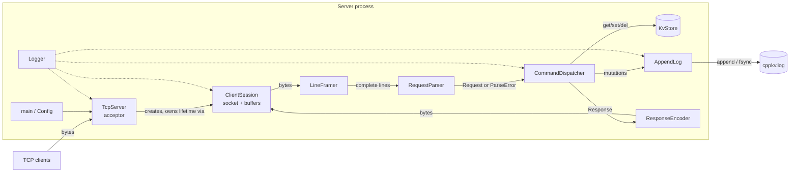

# CppKV — Architecture and Implementation Plan

Status: **living document**, written in Phase 0 and updated as phases land (currently Phase 5).
Sections marked *draft* are proposals that the phase implementing them confirms or revises; decisions taken
are recorded in [`docs/adr/`](adr/), and the protocol is specified in [`docs/protocol.md`](protocol.md).

---

## 1. Purpose

CppKV is an educational, Redis-inspired key-value database server written in modern C++20.
It accepts TCP clients, speaks a small documented text protocol, keeps string keys and values in memory,
and will later support concurrent clients, an append-only log for recovery, tests, sanitizers, CI and honest benchmarks.

It is **not** Redis, does not reuse Redis code, and does not aim for RESP or feature compatibility.

---

## 2. Requirements

### 2.1 Functional

| ID | Requirement |
|----|-------------|
| F1 | Accept multiple TCP clients on a configurable address and port. |
| F2 | Support `PING`, `SET`, `GET`, `DEL`, `EXISTS`, `DBSIZE`, `QUIT` with documented semantics. |
| F3 | Treat TCP as a byte stream: correctly handle requests split across reads and several requests in one read (pipelining). |
| F4 | Reject malformed, unknown and oversized requests with a defined error response; never crash on client input. |
| F5 | Values may contain spaces and may be empty. |
| F6 | Persist mutations to an append-only log and recover state on restart (Phase 6). |
| F7 | Shut down gracefully on SIGINT/SIGTERM: stop accepting, close sessions, flush and close the log (Phase 7). |

### 2.2 Non-functional

| ID | Requirement |
|----|-------------|
| N1 | C++20, CMake, builds on macOS (Apple Silicon, AppleClang) and Linux (GCC and Clang). |
| N2 | No data races (validated with TSan), no memory errors (ASan/UBSan) in the test suite. |
| N3 | Bounded resources: max request size, max connections, max pending output per client, bounded threads. |
| N4 | Unit-testable components with no hidden globals; networking, protocol and storage are separable. |
| N5 | Deterministic tests: synchronise on events (responses, futures, condition variables), not on `sleep`. |
| N6 | Every performance claim backed by a recorded, reproducible measurement. |
| N7 | Minimal third-party dependencies: Boost (headers only), GoogleTest, Google Benchmark. |

---

## 3. Milestones, MVP and non-goals

**MVP (v0.1, end of Phase 4):** a single server process, all seven commands, correct framing of fragmented and
pipelined input, request-size limits, unit tests and real-TCP integration tests. Clients may be served one at a time.

**v1.0 (end of Phase 10):** the project's Definition of Done — concurrent clients, AOF recovery with a stated
durability guarantee, graceful shutdown, sanitizer-clean CI on Linux and macOS, measured benchmarks, portfolio docs.

**Non-goals for v1.0** (listed so scope creep is a conscious decision):

- Replication, clustering, sharding across processes
- Key expiry/TTL, eviction policies, memory limits on the dataset
- Data types other than byte strings (lists, hashes, sets…)
- Transactions, scripting, pub/sub
- Authentication, TLS, ACLs
- RESP or any Redis client compatibility
- Binary-safe values (values containing CR/LF) — possible future protocol v2
- Log compaction / snapshots (the log grows without bound in v1 — a documented limitation)
- Windows support
- Lock-free data structures, custom allocators, io_uring, kernel bypass

---

## 4. Component architecture



| Component | Responsibility | Depends on | Phase |
|-----------|----------------|-----------|-------|
| `Config` | Parse CLI flags into an immutable struct with validated limits. | — | 3 (minimal), 7 |
| `Logger` | Levelled, timestamped lines to stderr; thread-safe. No external library. | — | 3, 7 |
| `KvStore` | Map from `std::string` key to `std::string` value. No knowledge of sockets or text. | std | 2 |
| `LineFramer` | Accumulates bytes; yields complete lines; enforces max line length. Pure, no I/O. | std | 4 |
| `RequestParser` | `parse_request(line)` → validated `Request` or `ProtocolError` (`std::variant`). Pure. | std | 4 |
| `CommandDispatcher` | Executes a `Request` against the store (and log), returns a `Response`. No I/O. | KvStore, AppendLog | 4, 6 |
| `ResponseEncoder` | Serialises a `Response` into wire bytes. Pure. | std | 4 |
| `ConnectionHandler` | Sans-I/O glue for one connection: `feed(bytes)`, `process(out)` runs framer → parser → dispatcher → encoder with bounded output batches. Added in Phase 4 so that complete protocol behaviour, including every split of the byte stream, is unit-testable without sockets. | all of the above | 4 |
| `ClientSession` | Owns one socket and a `ConnectionHandler`; only moves bytes (`read_some` 4 KiB → `feed`, `process` → `write`). | Asio, handler | 3, 4, 5 |
| `TcpServer` | Owns the acceptor; enforces max connections; tracks sessions for shutdown. | Asio | 3, 5, 7 |
| `AppendLog` | Appends mutation records, syncs per policy, replays and validates on startup. | std, Boost.CRC | 6 |

Design rule (implemented in Phase 4): **everything left of `ClientSession` is pure and socket-free.** The framer, parser, dispatcher, encoder
and store can each be unit-tested with plain strings. Only `ClientSession` and `TcpServer` touch Asio. This is the
main structural decision of the project; it is what makes fragmentation and malformed-input behaviour testable
without a network.

Abstractions are introduced only when there is a second implementation or a test seam that needs one. For example,
`KvStore` starts as a concrete class, not an interface; an interface appears only if Phase 5 benchmarks compare a
single-mutex store with a sharded store.

### 4.1 Ownership and lifetime (planned)

| Object | Owner | Lifetime |
|--------|-------|----------|
| `asio::io_context`, `TcpServer`, `KvStore`, `AppendLog`, `Logger` | `main` (stack / `std::unique_ptr`) | Whole process; destroyed in reverse order after shutdown completes. |
| `ClientSession` (sync model, Phase 3 — implemented) | Local object in `TcpServer::run()`'s accept loop; owns the socket (moved in) | One client connection; destructor closes the socket. See ADR 0001. |
| `ClientSession` (async model, Phase 5) | `std::shared_ptr`, kept alive by pending async handlers (`shared_from_this`) | Until the last handler finishes after the socket closes. |
| Sessions' reference to the store | Non-owning reference; store outlives all sessions by construction | — |

Rule: no raw owning pointers. Non-owning references are allowed only where the referenced object provably outlives
the referrer, and that is stated in a comment at the declaration.

### 4.2 Request lifecycle

1. Socket read returns *some* bytes (anything from 1 byte to many requests).
2. `LineFramer::feed(bytes)` appends to its buffer and extracts every complete line; an incomplete tail stays buffered.
3. Each line → `RequestParser::parse(line)` → `Request` or `ParseError`.
4. `CommandDispatcher::execute(request)` → `Response` (for mutations: write the log record first, then update memory).
5. `ResponseEncoder` appends bytes to the session's output buffer, in request order.
6. The session writes the output buffer; if it grows past a limit, the session stops reading (back-pressure).

---

## 5. Protocol v1 (*draft — finalised in `docs/protocol.md` in Phase 4*)

**Superseded by [`docs/protocol.md`](protocol.md)** (Phase 4), which is the normative specification. The draft below
is kept for history; the implemented protocol follows it, with the error check order and the early `TOO_LARGE`
detection defined precisely in `protocol.md`.

### 5.1 Why framing matters — a concrete example

A client calls `send("SET name hello\nGET name\n")` once. TCP may deliver it to the server as three reads:

```
read #1: "SE"
read #2: "T name hel"
read #3: "lo\nGET name\nDB"      <- also the start of the next pipelined request
```

A server that treats each `read` as one command would try to execute `SE`, then `T name hel`, and would corrupt
or reject both. CppKV instead keeps a per-connection buffer: after read #3 it extracts exactly
`SET name hello` and `GET name`, and keeps `DB` buffered until its `\n` arrives.

### 5.2 Requests

- A request is one line terminated by `LF` (`\n`). A single `CR` immediately before the `LF` is stripped,
  so both `nc` (LF) and `telnet` (CRLF) work.
- Tokens are separated by **exactly one** ASCII space. Leading spaces, trailing spaces and double spaces
  produce `ERR PROTOCOL` — with one exception: the `SET` value (below).
- Command names are ASCII case-insensitive (`get` = `GET`). Keys are case-sensitive.
- Empty lines are ignored and produce no response. Every non-empty line produces exactly one response.

```
PING
SET <key> <value>      value = every byte after the space that follows <key>, up to end of line
GET <key>
DEL <key>
EXISTS <key>
DBSIZE
QUIT
```

`SET greeting hello  world` stores the value `hello  world` (two spaces preserved).
`SET k ` (trailing space) stores the empty value. `SET k` (no separator) is `ERR WRONG_ARGS`.

### 5.3 Limits and character rules

| Item | Rule (initial default) |
|------|------------------------|
| Line length | ≤ 65 536 bytes, excluding the terminator. Longer → `ERR TOO_LARGE`, then the server closes the connection (it cannot reliably resynchronise mid-line). |
| Key | 1–512 bytes, each byte in printable ASCII `0x21`–`0x7E` (no spaces or control characters). Otherwise `ERR INVALID_KEY`. |
| Value | 0 or more bytes; any byte except `CR` (`0x0D`) and `LF` (`0x0A`). A bare `CR` inside a line → `ERR PROTOCOL`. |
| Encoding | The server treats keys and values as bytes; it does not validate UTF-8. |

### 5.4 Responses

Every response is one line terminated by `CRLF`.

| Response | Meaning | Returned by |
|----------|---------|-------------|
| `PONG` | Server is alive | `PING` |
| `OK` | Mutation applied | `SET` |
| `VALUE <len> <bytes>` | Found; `<len>` is the exact byte length of the value (`VALUE 0 ` for an empty value) | `GET` |
| `NIL` | Key does not exist (not an error) | `GET` |
| `INT <n>` | Integer result | `DEL` (0/1), `EXISTS` (0/1), `DBSIZE` |
| `BYE` | Server will close the connection after this line | `QUIT` |
| `ERR <CODE> <message>` | Request failed; `<CODE>` is machine-readable, `<message>` is for humans | any |

Error codes: `UNKNOWN_COMMAND`, `WRONG_ARGS`, `INVALID_KEY`, `PROTOCOL`, `TOO_LARGE`, `BUSY`
(sent once and then closed when the connection limit is reached), `INTERNAL`.
Only `TOO_LARGE`, `BUSY` and `INTERNAL` close the connection; all others keep it open.

The length prefix in `VALUE` lets a client verify it received the whole value and keeps the format
extensible to binary-safe values later.

### 5.5 Example session

```
$ nc localhost 7379
PING
PONG
SET city Frankfurt am Main
OK
GET city
VALUE 17 Frankfurt am Main
EXISTS nope
INT 0
FLY away
ERR UNKNOWN_COMMAND unknown command 'FLY'
DBSIZE
INT 1
QUIT
BYE
```

(Port 7379 is a placeholder default, chosen to avoid colliding with a local Redis on 6379.)

---

## 6. Store semantics (Phase 2 — implemented in `src/cppkv/store/kv_store.hpp`)

| Method | Returns | Protocol command |
|--------|---------|------------------|
| `bool set(std::string key, std::string value)` | `true` if inserted, `false` if replaced | `SET` |
| `std::optional<std::string> get(std::string_view key) const` | copy of value, or `nullopt` | `GET` |
| `bool erase(std::string_view key)` | `true` if the key existed | `DEL` |
| `bool contains(std::string_view key) const` | presence | `EXISTS` |
| `std::size_t size() const noexcept` | number of keys | `DBSIZE` |

- Keys and values are arbitrary byte strings (empty allowed, embedded `'\0'` allowed). Validation happens in the
  parser, not the store, so the store stays rule-free and the persistence layer can replay any record.
- An empty value is distinct from a missing key (`optional` holding `""` vs `nullopt`).
- Lookups take `std::string_view` and use C++20 heterogeneous lookup (transparent hash + `std::equal_to<>`), so the
  Phase 4 parser can look up a key that is a view into the receive buffer without allocating.
  Heterogeneous `erase(key)` is C++23, so `erase` does `find` + `erase(iterator)`.
- `set` takes sink parameters by value and moves them in: zero copies for temporaries, one for lvalues.
- `KvStore` is non-copyable and non-movable: one database per server, and accidental copies would fork the data.
- `get` returns a copy, not a reference or `string_view`, because once Phase 5 adds concurrency a reference into
  the map could dangle as soon as the lock is released. Copy cost is measured in Phase 8 before anyone optimises it.
- Exception safety: `set` gives the strong guarantee (if allocation throws, the map is unchanged), which
  `std::unordered_map::insert_or_assign` provides for a single element; `erase` never throws.
- Known limitation: `std::hash<std::string_view>` is unseeded in libstdc++ and libc++, so a client who can choose
  keys could craft many colliding keys and degrade operations to O(n) ("hash flooding"). Acceptable for a
  loopback-bound educational server; revisit only if the server is exposed or benchmarks show it matters.
- Thread safety: **none in Phase 2** (documented). Synchronisation is added deliberately in Phase 5.

---

## 7. Concurrency (Phase 5 — **decided, see [ADR 0002](adr/0002-concurrency-model.md)**)

Implemented: async Asio, one `io_context` on a fixed pool of `--threads` threads (default 4), a strand per session,
one `std::mutex` in `CommandDispatcher` around the store, `--max-connections` (default 128) enforced by
`SessionRegistry`. The comparison below was the Phase 0 starting point; ADR 0002 contains the full reasoning.

Phase 0 candidates:

| Model | Pros | Cons |
|-------|------|------|
| Thread per connection (capped) | Simplest code; blocking I/O | Threads ≈ clients; idle clients still cost a thread; cap must be enforced. |
| Fixed thread pool + blocking sockets | Bounded threads | An idle client blocks a pool thread (head-of-line blocking); needs timeouts. |
| Async, 1 `io_context` thread | No locks needed on the store; easy to reason about | Uses one core; a slow command (or `fsync`) stalls every client. |
| Async, N threads + per-session strand + store lock | Parallel; bounded threads | Most complex; needs careful lifetime (`shared_from_this`) and locking. |

Phase 0 leaned towards `std::shared_mutex` or shards. Phase 5 chose a plain `std::mutex` instead: it is the simplest
correct option, and anything more is an optimisation for Phase 8 to justify with measurements. The data race it
prevents (concurrent inserts during a rehash) was demonstrated with TSan by removing the lock; see ADR 0002.

---

## 8. Persistence (Phase 6 — **implemented, see [ADR 0003](adr/0003-persistence.md)**)

ADR 0003 is the authoritative description, including the exact durability guarantees, the classification of torn
tails versus corruption, and the fail-stop behaviour. The Phase 0 draft below was implemented as written, except
that the open question is now decided: damage followed by further data refuses startup (`--recovery strict`,
default), and `--recovery truncate` is the explicit override.

Append-only log (`cppkv.log`) in a data directory.

```
file   := header record*
header := "CPPKVLOG" u16 version
record := u32 payload_len | u32 crc32(payload) | payload        (little-endian)
payload:= u8 op (1=SET, 2=DEL) | u32 key_len | key | [ u32 value_len | value ]   (value only for SET)
```

Write path: encode record → append to log → (sync per policy) → apply to memory → respond `OK`.

Sync policy (`--sync`):

| Policy | Guarantee when the client sees `OK` |
|--------|-------------------------------------|
| `always` | The record was handed to the OS **and** `fsync`'d (on macOS: `fcntl(F_FULLFSYNC)`, because plain `fsync` does not flush the drive cache). Survives power loss, subject to hardware honesty. |
| `interval` | Written to the OS; synced at most N ms later. Survives a process crash; power loss may lose the last N ms. |
| `never` | Written to the OS only. Survives a process crash; power loss may lose anything the OS had not flushed. |

Recovery: replay records in order. A truncated final record (short read) or a CRC mismatch is treated as a torn
write from a crash: log a warning with the byte offset, truncate the file to the last good record, continue.
Whether a CRC failure *followed by valid records* should instead refuse to start (`--recovery=strict`) is an
open decision for Phase 6.

Known v1 limitation: no compaction — the log grows with every mutation, and restart time grows with it.

---

## 9. Error-handling conventions

- **Expected outcomes are values**, not exceptions: missing key → `std::nullopt`; bad request → `ParseError`;
  Asio network errors → `boost::system::error_code` overloads.
- **Exceptions are for the unexpected**: allocation failure, failing to open the log at startup, logic bugs.
- Exceptions never escape a session handler: the session catches, logs with context, replies `ERR INTERNAL`
  if possible, and closes **that** connection only. Nothing is swallowed silently.
- Startup errors (bad config, port in use, unreadable log) print a clear message and exit non-zero.
- `assert` documents internal invariants; it is not used to validate client input.

---

## 10. Configuration and resource limits (Phases 3 and 7)

Command-line flags only (no config-file library). Implemented so far: `--bind`, `--port`, `--threads`,
`--max-connections`. The line limit is fixed at 64 KiB (`ServerConfig::max_line_bytes`), and output is bounded by
writing responses in ~64 KiB batches (`ClientSession::kOutputFlushBytes`). The rest are planned:

| Flag | Default | Purpose |
|------|---------|---------|
| `--bind` | `127.0.0.1` | Listen address (loopback by default: there is no auth). |
| `--port` | `7379` | Listen port. |
| `--max-connections` | `128` | 1–10 000. Above this, new clients get `ERR BUSY` and are closed (Phase 5). Well below the measured fd limits (macOS Terminal 2560, typical Linux 1024). |
| `--max-line-bytes` | `65536` | Request size limit. |
| `--max-output-bytes` | `1 MiB` | Per-client pending-response limit; above it the session stops reading (back-pressure). |
| `--idle-timeout-ms` | `0` (off) | Close clients idle this long; mitigates slow/partial-line clients. |
| `--threads` | `4` | I/O threads, 1–64 (Phase 5). |
| `--data-dir` | `./data` | Log location (Phase 6). |
| `--sync` | `always` | Durability policy (Phase 6). |
| `--log-level` | `info` | `debug`, `info`, `warn`, `error`. |

Why `--max-output-bytes` matters: a client can pipeline thousands of `GET`s without reading the responses.
Without a limit, the server buffers every response in memory — an unbounded-memory bug that only shows up under
a misbehaving client.

---

## 11. Repository layout (planned; created incrementally)

```
CppKV/
├── CMakeLists.txt            top-level project; options; add_subdirectory()
├── CMakePresets.json         debug, release, asan-ubsan, tsan (CLion reads these)
├── cmake/
│   ├── CompilerWarnings.cmake
│   └── Sanitizers.cmake
├── src/
│   ├── CMakeLists.txt        cppkv_core static library + cppkv-server executable
│   ├── main.cpp
│   └── cppkv/                headers next to sources; included as "cppkv/store/kv_store.hpp"
│       ├── common/           config, logger
│       ├── store/            kv_store
│       ├── protocol/         line_framer, request_parser, response_encoder
│       ├── server/           tcp_server, client_session, command_dispatcher
│       └── persistence/      append_log
├── tests/
│   ├── unit/                 store, framer, parser, encoder, dispatcher, log
│   └── integration/          real TCP: server on an ephemeral port, client in-process
├── bench/                    Google Benchmark micro-benchmarks (Phase 8)
├── tools/                    cppkv-cli test client and load generator
├── scripts/                  demo and benchmark helpers
├── docs/
│   ├── architecture.md
│   ├── protocol.md           (Phase 4)
│   ├── benchmarks.md         (Phase 8)
│   └── adr/                  short Architecture Decision Records
├── .github/workflows/ci.yml  (Phase 9, or earlier — see §14)
├── README.md
└── PROGRESS.md
```

One static library (`cppkv_core`) holds all components; the server, tests and benchmarks link to it.
It may be split later only if build times or dependency direction make that worthwhile.

---

## 12. Build and dependency strategy (implemented in Phase 1)

| Dependency | How it is obtained | Why |
|------------|--------------------|-----|
| Boost 1.83–1.90 — Asio, later CRC | `find_package(Boost 1.83 CONFIG REQUIRED)`; macOS: Homebrew (1.90.0 installed); Linux/CI: `apt install libboost-dev` (Ubuntu 24.04 ships 1.83) | Asio is header-only; only `Boost::headers` is linked. |
| GoogleTest | CMake `FetchContent`, pinned to `v1.17.0` (needs CMake ≥ 3.16; checked) | Reproducible, no system package version drift; not installed via Homebrew on the Mac. |
| Google Benchmark | `FetchContent`, pinned tag (latest upstream: `v1.10.0`) (Phase 8) | Same reason. |

CMake minimum: **3.25** (Ubuntu 24.04 has 3.28; the Mac has 4.4). Written as
`cmake_minimum_required(VERSION 3.25...4.4)` so CMake 4 applies its newer policies without warnings.

Three Boost pitfalls to avoid deliberately:
1. CMake 3.30+ (including the Mac's 4.4) removed the old `FindBoost` module behaviour by policy; use **CONFIG mode**.
2. Boost 1.89+ (including the Mac's 1.90) removed the Boost.System stub library, so the old idiom
   `find_package(Boost COMPONENTS system)` fails there. CppKV requests no compiled components.
3. Boost 1.90 (Asio 1.38) no longer ships long-deprecated Asio APIs: `io_service.hpp` and `io_context::work`
   are gone (checked in the 1.90 headers). Most online tutorials still use them. CppKV uses only the modern API
   (`io_context`, `make_work_guard`, free-function `asio::post`), which also exists in 1.83. Phase 1 compiles
   against both 1.83 and 1.90 to keep that true.

Compiler warnings (see `cmake/CompilerWarnings.cmake`): `-Wall -Wextra -Wpedantic -Wshadow -Wconversion
-Wsign-conversion -Wnon-virtual-dtor -Wold-style-cast -Woverloaded-virtual` and a few more; `-Wnull-dereference`
on Clang only (GCC reports false positives inside Asio at `-O3`). `-Werror` only in the `ci` preset, so local
experiments are not blocked. `BOOST_ASIO_NO_DEPRECATED` makes Boost 1.83 reject the APIs that 1.90 removed.

Build types via `CMakePresets.json`: `debug`, `release`, `asan-ubsan` (ASan + UBSan), `tsan` (TSan; cannot be
combined with ASan). Tests are registered with CTest through `gtest_discover_tests`.

---

## 13. Platform concerns: macOS (development) vs Linux (validation)

| Concern | macOS (M2, AppleClang/libc++) | Linux (GCC/Clang, libstdc++) | Plan |
|---------|-------------------------------|------------------------------|------|
| Toolchain (verified) | macOS 27.0.1, Apple clang 21.0.0, Command Line Tools only (no full Xcode), CMake 4.4.0, Ninja 1.13.2, Boost 1.90.0 | Ubuntu 24.04, GCC 13.3, Clang 18.1.3, CMake 3.28.3 | Code must stay inside the intersection: CMake 3.25 features, Boost 1.83 APIs, C++20 features that GCC 13, Clang 18 and Apple clang 21 all support. |
| C++20 library gaps | `std::jthread`/`std::stop_token` **compile and run** with `-std=c++20` (verified). Other libc++ gaps may still exist. | Complete in GCC 13. | `std::jthread` is allowed; any other recent facility gets a quick probe on both platforms before use. |
| CMake 4 | CMake 4 drops compatibility with projects that declare `cmake_minimum_required` < 3.5; fetched dependencies must declare a modern minimum. CLion may use its bundled CMake rather than Homebrew's. | 3.28 | Pin dependency versions that declare ≥ 3.5 (GoogleTest 1.17: 3.16). In CLion, check which CMake is selected (Settings → Build → Toolchains). |
| Durable writes | `fsync` does not flush the drive's cache; `F_FULLFSYNC` does. | `fsync`/`fdatasync`. | Platform `#ifdef` in one function in `AppendLog`. |
| SIGPIPE on write to closed socket | Can kill the process. | Same. | Asio already suppresses it for its sockets: `SO_NOSIGPIPE` on macOS (set on every created and accepted socket), `MSG_NOSIGNAL` on Linux (checked in the Asio sources; tested by `ServerSurvivesWritingToResetClient`). Revisit a process-wide `SIG_IGN` in Phase 7 if non-socket pipes appear. |
| Sanitizers | ASan, UBSan, TSan work; **LeakSanitizer is not supported** on macOS. | All, including LSan. | Leak checks run in Linux CI. |
| Profiling | Instruments needs full Xcode (only Command Line Tools are installed); `sample` works without it; no Valgrind on Apple Silicon; no `perf`. | `perf`, Valgrind, heaptrack. | Profile on Linux for Phase 8 write-ups; install Xcode only if Instruments becomes worth it. |
| File descriptor limit | Terminal `ulimit -n` is 2560 (verified); apps launched from the Dock (e.g. CLion) may inherit a different launchd limit. | Commonly 1024. | Defaults stay far below; the server logs its `RLIMIT_NOFILE` at startup (Phase 7); load tests record it. |
| Benchmark stability | MacBook Air is fanless: sustained load triggers thermal throttling. | Cloud VMs have noisy neighbours. | Repeat runs, report variance, record hardware; never compare numbers across machines. |
| CPU architecture | arm64 | usually x86_64 | Never rely on `char` signedness or struct layout for the log format; encode bytes explicitly. |
| CLion environment | GUI apps may not inherit the shell `PATH`, so Homebrew prefixes might not be found. | — | If CMake cannot find Boost, set `CMAKE_PREFIX_PATH=/opt/homebrew` in the preset. |

---

## 14. Phase plan and acceptance criteria

Roadmap order is kept, with two small adjustments proposed for approval:
- **CMake presets and sanitizer configurations move into Phase 1** (cheap, and every later phase benefits from
  running tests under ASan/UBSan from day one). Phase 9 still owns the CI matrix and final audit.
- **Optional: a minimal Linux GitHub Actions job in Phase 2**, so macOS/Linux divergence is caught early rather
  than in Phase 9. Requires a GitHub repository; nothing is pushed without explicit permission.

| Phase | Objective | Acceptance criteria |
|-------|-----------|--------------------|
| 0 | Requirements & architecture | This document, `README.md`, `PROGRESS.md` exist; toolchains inspected; open decisions listed and answered by the owner. |
| 1 | Skeleton & build | Clean configure + build with presets on macOS (CMake 4.4, Boost 1.90) and Linux (CMake 3.28, Boost 1.83 and 1.90); `cppkv-server --version` runs; a test that compiles against Boost.Asio passes under `ctest`; zero warnings; `asan-ubsan` preset passes; `.gitignore` in place. |
| 2 | In-memory store | `KvStore` API as in §6; unit tests cover empty value, replacement, missing key, delete-twice, size after mixed ops, large values; ASan/UBSan clean. |
| 3 | TCP server (sync) | Server accepts a client, answers `PING`, handles `QUIT`, client reset and mid-line disconnect without crashing; `nc` examples documented; integration test on an ephemeral port. |
| 4 | Protocol & dispatcher (**MVP**) | `docs/protocol.md` final; every command works over TCP; tests for byte-by-byte fragmentation, many requests in one write, oversized line, bare CR, unknown command, wrong arity, invalid key. |
| 5 | Concurrent clients | Model chosen and justified (ADR); N clients interleaving reads/writes produce correct results; connection cap enforced; TSan clean on Linux and macOS; no `sleep`-based synchronisation in tests. |
| 6 | Persistence | Restart recovers SETs and DELs; torn tail and CRC corruption tests pass; durability guarantee per sync policy documented and tested where testable. |
| 7 | Reliability | SIGINT/SIGTERM shut down within a bounded time with no leaks (LSan on Linux); limits configurable; idle timeout and back-pressure tested; useful log lines for connect, disconnect, errors, recovery. |
| 8 | Benchmarks | Micro-benchmarks for the store; network load generator reporting throughput, p50/p95/p99 and RSS for several client counts and read/write mixes; methodology and environment recorded; at least one profile-driven observation. |
| 9 | CI & quality | GitHub Actions: Linux GCC + Clang, macOS AppleClang; sanitizer jobs; `-Werror`; documented clean build reproduced from README. |
| 10 | Portfolio release | README, diagrams, measured results, limitations, demo script, release tag, resume bullets limited to verified features. |

---

## 15. Risks

| Risk | Impact | Mitigation |
|------|--------|-----------|
| Boost/CMake version drift between Homebrew and Ubuntu | Build breaks on one platform | CONFIG-mode `find_package`, headers-only, minimum version 1.83; CI on both. |
| Apple libc++ missing a C++20 facility | Code compiles on Linux only | Phase 1 feature probe; avoid the facility or wrap it. |
| Flaky timing-based tests | Lost trust in CI | Ephemeral ports; wait on responses/futures; bounded timeouts used only as failure detectors. |
| Unbounded memory from slow or malicious clients | Server OOM | Line limit, output back-pressure, connection cap, idle timeout. |
| Async session lifetime bugs (use-after-free) | Crashes under load | `shared_from_this` discipline; ASan + stress tests in Phase 5. |
| Misleading latency numbers | Dishonest portfolio claims | Report percentiles, not just averages; watch for *coordinated omission* (a closed-loop load generator under-reports tail latency because it stops sending while the server is slow); record environment. |
| Overstated durability | Incorrect claims in interviews | Guarantees stated per sync policy; `F_FULLFSYNC` vs `fsync` documented. |
| Scope creep (TTL, RESP, replication) | Unfinished project | Non-goals list (§3); new features need an explicit decision. |

---

## 16. Open decisions for the project owner

1. **Repository location** on the Mac (for CLion), e.g. `~/CLionProjects/CppKV`.
2. **Dependency strategy** in §12 (system Boost, FetchContent for GoogleTest/Benchmark).
3. **Protocol v1 draft** in §5 — especially the strict single-space rule and the `VALUE <len> <bytes>` format.
4. **Roadmap adjustments** in §14 (presets/sanitizers in Phase 1; optional early CI).
5. **Licence** for the public repository (MIT is common for portfolio projects) — needed by Phase 1 if the repo
   will be public.
